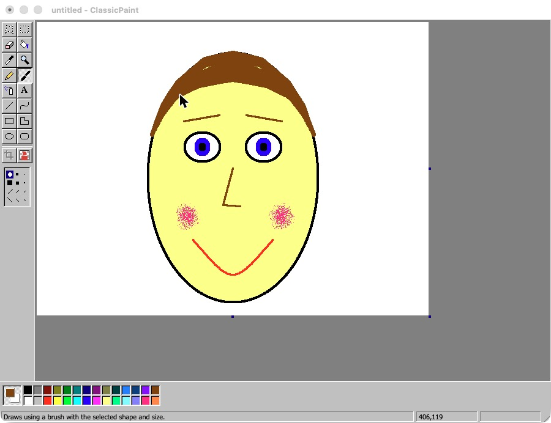

# ClassicPaint

A native macOS paint program that recreates the look and feel of the classic Windows 9x-era paint app, plus a few modern touches like Crop and AI-powered Remove Background.

Written in Swift with AppKit. No dependencies and no Xcode project: one build script and the Command Line Tools are all you need.



> **Disclaimer:** ClassicPaint is an independent fan project. It is not affiliated with, endorsed by, or sponsored by Microsoft. "Microsoft Paint" and "Windows" are trademarks of Microsoft Corporation. All code and artwork in this repository are original.

## Features

**The classic tool box: all 16 tools, in the original order**
Free-Form Select, Select, Eraser / Color Eraser, Fill With Color, Pick Color, Magnifier, Pencil, Brush (12 shapes), Airbrush, Text, Line, Curve (two bend points), Rectangle, Polygon, Ellipse, Rounded Rectangle.

**Faithful details**
- Aliased, pixel-crisp drawing and exact-match flood fill
- The original 28-color palette: left click sets the foreground color, right click (or Control-click) sets the background color, and double-click edits a color
- Options box under the tool box: line widths, brush shapes, eraser and airbrush sizes, fill styles, opaque or transparent selection, zoom levels
- Selections: drag to move, Option-drag to copy, Shift-drag to "smear", arrow keys to nudge, and 8 handles to stretch
- **Smart Erase** (Edit menu, toolbox button or ⌥⌫): select an object and it disappears, with the spot filled in from the surrounding texture and colors (content-aware fill), not with a flat color. Delete keeps working as before.
- Any selection shape with Free-Form Select, and **Invert Selection** (⇧⌘I) to select everything except the shape. Delete erases the selected area and Crop cuts the picture to it.
- Blue handles on the canvas edge to resize the picture
- Windows 9x chrome: 3D bevels, dithered pressed buttons, status bar with coordinates and size
- Image menu: Flip/Rotate, Stretch/Skew, Invert Colors, Attributes, Clear Image, Draw Opaque
- Zoom from 12.5% to 1600% with ⌘/⌃ and + / −, ⌘/⌃ + mouse wheel (zooms around the pointer) or trackpad pinch, plus a pixel grid, full-screen View Bitmap, toggle tool box, color box and status bar
- Set as Desktop Background, Copy To / Paste From, system clipboard in both directions
- 50 levels of Undo / Repeat

**Modern additions**
- **Menus in Window** (View menu, ⌥⌘M): shows File, Edit, View, Image, Colors and Help as a Windows-style menu bar inside the window. Option+letter opens a menu, like Alt+letter on Windows. On by default, and the choice is remembered.
- **Tabs**: open several pictures at once. Each tab keeps its own undo history, zoom and file. ⌘N opens a new picture, ⌘W closes a tab, ⌃⇥ or ⇧⌘] / ⇧⌘[ switches tabs, and middle-click on a tab closes it. The tab bar appears automatically when more than one picture is open. With a single picture it stays hidden unless you choose **View → Show Tab Bar** (⇧⌘T).
- **Crop** to the current selection (⇧⌘X, or the toolbox button)
- **Remove Background** using Apple's on-device subject segmentation (⇧⌘B, or the toolbox button). It works on the whole picture or on a selection and needs macOS 14 or later.
- Transparency support, shown as a checkerboard and preserved in PNG and TIFF files

**File formats:** PNG, BMP (24-bit), JPEG, GIF, TIFF.

## Download

Get the ready-to-run app from the **[latest release](https://github.com/udiweinstein/ClassicPaint/releases/latest)**. Download `ClassicPaint.zip`, unzip it and drag ClassicPaint into Applications. Then see [Opening a downloaded copy](#opening-a-downloaded-copy) for the first launch.

## Requirements

- macOS 11 Big Sur or later (Remove Background needs macOS 14 Sonoma or later)
- Apple Silicon or Intel (the build is a universal binary)
- To build: Xcode or just the Command Line Tools (`xcode-select --install`)

## Build and run

```bash
git clone https://github.com/udiweinstein/ClassicPaint.git
cd ClassicPaint
./build.sh
open build/ClassicPaint.app
```

`build.sh` compiles a universal binary, generates the app icon, ad-hoc signs the app and also creates `build/ClassicPaint.zip`, ready to share.

### Opening a downloaded copy

The app is not notarized, so macOS Gatekeeper blocks it the first time:

- Right-click the app, choose **Open**, then confirm, **or**
- open **System Settings → Privacy & Security** and click **Open Anyway**, **or**
- run `xattr -dr com.apple.quarantine /Applications/ClassicPaint.app`

## Keyboard shortcuts

| Action | Shortcut |
|---|---|
| New picture (tab) / Open / Close tab | ⌘N / ⌘O / ⌘W |
| Next / previous tab | ⌃⇥ or ⇧⌘] / ⇧⌘[ |
| Show / Hide Tab Bar | ⇧⌘T |
| Invert Selection | ⇧⌘I |
| Smart Erase (fill selection from surroundings) | ⌥⌫ |
| Menus in Window on / off | ⌥⌘M |
| Undo / Repeat | ⌘Z / ⌘Y |
| Cut / Copy / Paste / Select All | ⌘X / ⌘C / ⌘V / ⌘A |
| Crop to selection | ⇧⌘X |
| Remove Background | ⇧⌘B |
| Flip/Rotate · Stretch/Skew · Attributes | ⌘R · ⌥⌘W · ⌘E |
| Invert Colors · Clear Image | ⌘I · ⇧⌘N |
| Tool Box · Color Box · Grid · View Bitmap | ⌘T · ⌘L · ⌘G · ⌘F |
| Zoom in / out / normal | ⌘ or ⌃ with + / − (or the mouse wheel, or pinch) / ⌘0 |

## Project layout

```
Sources/ClassicPaint/
  main.swift               app entry point (and icon export for the build)
  AppDelegate.swift        window, menus, dialogs, file I/O, Fonts toolbar
  CanvasView.swift         canvas, all tool interactions, selection, text, crop
  Chrome.swift             Windows 9x look: tool box, color box, status bar, icons
  Bitmap.swift             pixel buffer, rasterizing, flood fill, transforms
  BackgroundRemover.swift  Vision-based Remove Background
  State.swift              tools, palette, document and undo stack
  SmartErase.swift         content-aware fill (multi-scale PatchMatch inpainting)
  Tabs.swift               tab bar and multi-document handling
  WindowMenuBar.swift      optional Windows-style menu bar inside the window
build.sh                   build script
watch.sh                   optional dev helper: rebuilds when a .rebuild file appears
Info.plist                 app bundle metadata
```

## Credits

Built by Udi Weinstein with the help of Claude (Anthropic), an AI assistant that wrote most of the code.

## License

[MIT](LICENSE) © 2026 Udi Weinstein
